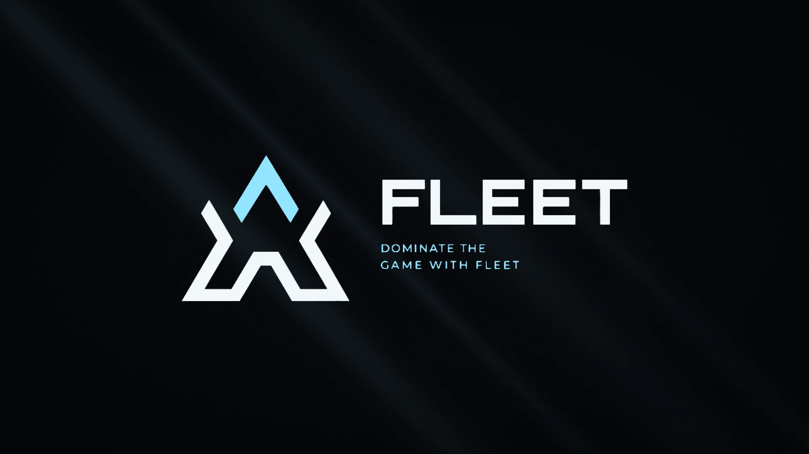
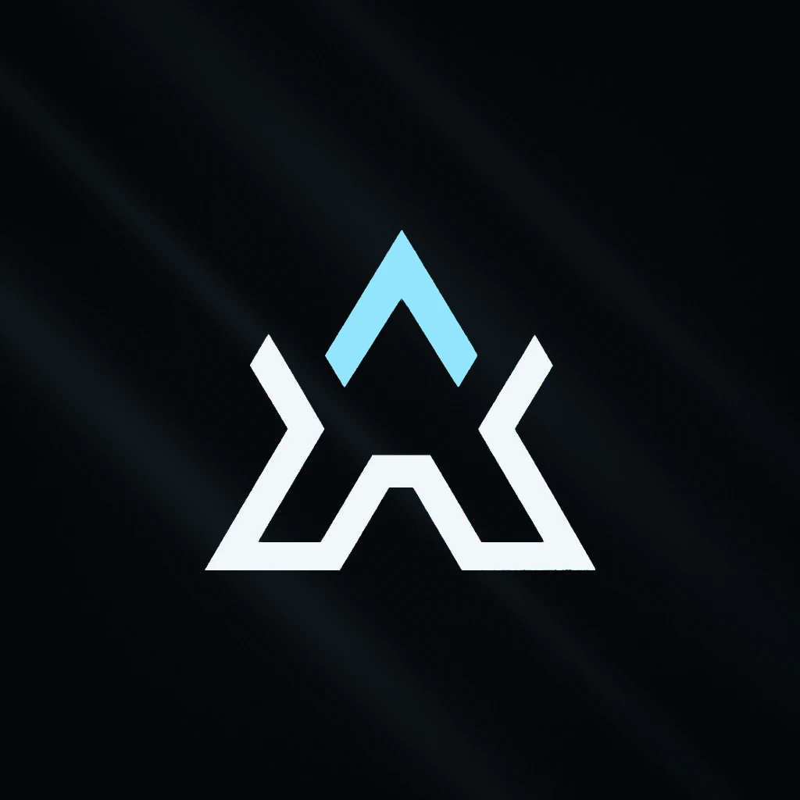

 

### ▲ About me

I'm someone who likes himself, and likes writing code.

I turn ideas into things you can actually use — clean interfaces, reliable systems, and the small details that make the final result feel complete. Most of my work lives in private repositories, but the way I work is the same either way: **try, learn, refine, then try again.**

Right now almost all of my time goes into **Fleet**.

<table>
<tr>
<td width="140" align="center" valign="middle">
  
</td>
<td valign="middle">

### Fleet

A lightweight in-game overlay for **FiveM**, built end to end by our team — from the native client to the license server and the Discord bot.

`stream-proof` &nbsp;·&nbsp; `low-spec mode` &nbsp;·&nbsp; `cloud configs` &nbsp;·&nbsp; `live support`

</td>
</tr>
</table>

  <a href="https://discord.gg/fleet"><b>Join the Discord →</b></a>

### ▲ Toolbox

  

  <b>Simple. Fast. Refined.</b> — Better than yesterday...

